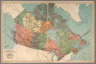

# Canadian Archival Maps (Gigapixel Tiles for StoryMapJS)

This repository hosts pre-sliced Zoomify tile pyramids for use with Knight Lab StoryMapJS.

## Instructions for StoryMapJS

In StoryMapJS, open **Options > StoryMap Type > Gigapixel**.  
Click the **copy button** on each box below to paste the values directly into the corresponding StoryMap options fields:
* **URL**
* **Max Width**
* **Max Height**
* **Attribution**

---

### 1. Canada & Newfoundland (1935)

[](https://www.davidrumsey.com/luna/servlet/detail/RUMSEY~8~1~253284~5518819)

* **Source:** [David Rumsey Historical Map Collection (Public Domain / CC BY-NC-SA 3.0)](https://www.davidrumsey.com/luna/servlet/detail/RUMSEY~8~1~253284~5518819)
* **URL:**
```text
https://elayyanm1.github.io/gigapixel/Gigpixel1935/
```
* **Max Width:**
```text
9985
```
* **Max Height:**
```text
6656
```
* **Attribution:**
```html
<a href="https://www.davidrumsey.com/luna/servlet/detail/RUMSEY~8~1~253284~5518819">Alexander Gross, F.R.G.S., "Geographia" Map Co. (1935).</a>, Public domain / <a href="https://creativecommons.org/licenses/by-nc-sa/3.0/">CC BY-NC-SA 3.0</a>, via David Rumsey Historical Map Collection. Tiled for Zoomify.
```
